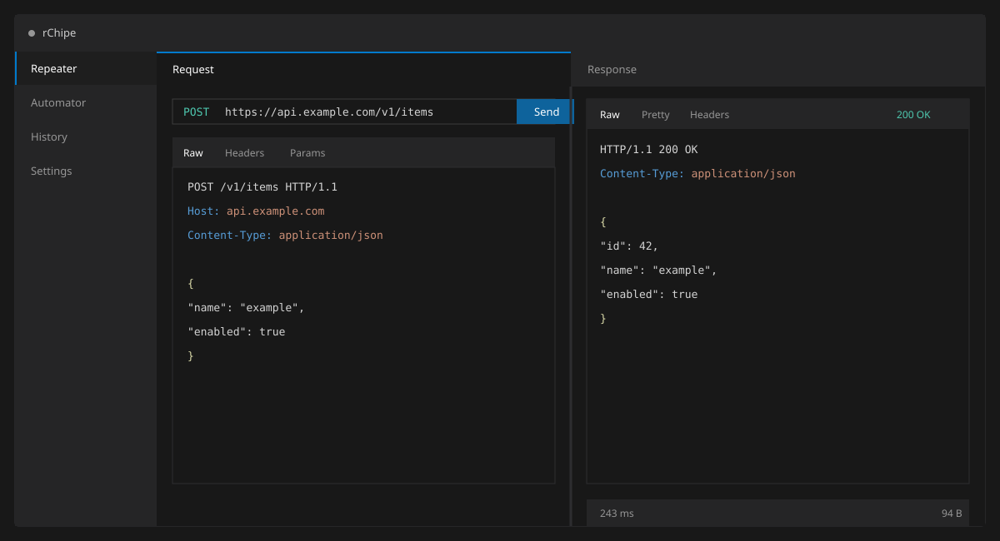

# rChipe

rChipe is a desktop HTTP client for editing, sending and inspecting requests. It is built with Python and Qt.



## Features

- Raw HTTP request editor and response viewer
- Repeater and parameterized batch requests
- Request history
- cURL import and export
- JSON and XML formatting
- Configurable proxy, TLS verification and timeout settings

## Installation

Python 3.10 or newer is required.

```bash
python3 -m pip install -r requirements.txt
python3 rChipe.py
```

## Shortcuts

| Shortcut | Action |
|---|---|
| `Ctrl+Enter` | Send request |
| `Ctrl+B` | Toggle sidebar |
| `Ctrl+1` | Repeater |
| `Ctrl+2` | Automator |
| `Ctrl+3` | History |
| `Ctrl+4` | Settings |

## Updating

Run the updater from the directory where `.update_rChipe` should be stored:

```bash
sudo python3 update.py
```
